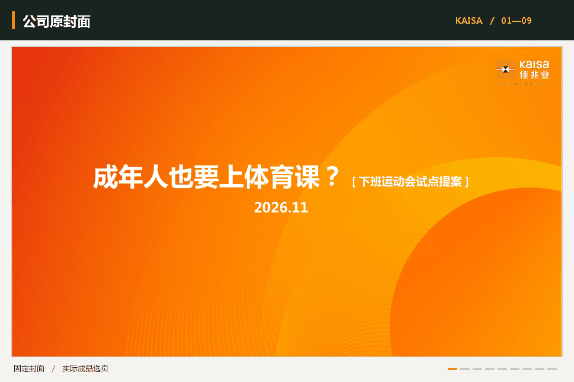

# 佳兆业通用汇报

**v3.2**　·　[技能入口](artifact-template-kaisa-ppt/SKILL.md)　·　[公司 PPT 模板](artifact-template-kaisa-ppt/references/sources.md)　·　[宋体一页纸母版](artifact-template-kaisa-ppt/assets/one-page-report.docx)

给出议题、目标读者和手头资料，可以做成面向会议的可编辑 PPT，也可以单独做一张 A4。集团决策、业务运营、专业审议、一线交接、培训和对外说明均可使用。产品、岗位和职级都不限定写法，读者需要解决的问题决定写什么。

## 看一次实际交付

**《成年人也要上体育课？》** 选取文体场馆运营场景，讨论一处场馆能否把下班后的 55 分钟做成可单买的活动。样稿供场馆运营负责人讨论，比较正常订场与组课的增量收益，列明付费需求、三站玩法、招募、时段敏感性及四场后的复盘安排。活动尚属提案，七张活动图均为 AI 生成的方案效果图。票价、成本和报名目标都是演算假设。公司业务背景参考[集团文体业务介绍](https://www.kaisagroup.com/Server/PE.aspx?top=1)和[集团公开活动报道](https://www.kaisagroup.com/tc/News/newsDt.aspx?id=10006547&p=0)。

[打开完整 PDF](demo/after-work-games.pdf)　·　[下载可编辑 PowerPoint](demo/after-work-games.pptx?raw=true)　·　[下载 Word 决策一页纸](demo/after-work-games-brief.docx?raw=true)

## 同一套格式，不同的汇报任务

| 谁在用 | 希望读者看完能做什么 | 适合的材料 |
|---|---|---|
| 一线员工、班组长 | 完成操作、接班或处理例外 | 带标注的动作图、流程、交接要点 |
| 业务及职能团队 | 理解偏差、协调接口或改进服务 | 期间对比、原因证据、岗位安排 |
| 管理层或决策人 | 比较选项、投入和经营影响 | 方案比较、测算、需要决定的事项 |
| 面向合作方或公众的团队 | 了解事实、进展及需要配合的事项 | 经确认的信息、履约节点、告知或协调材料 |
| 个人或跨部门小组 | 用一张纸把事情讲清楚 | 通知可只写一段，复盘、培训或申请可依题分节 |

## 页面怎样制作

PPT 整套沿用公司母版、原封面和原封底，Word 沿用固定 A4 宋体母版及标题、署名、正文的层级。[固定模板清单](artifact-template-kaisa-ppt/references/fixed-templates.md)。准备材料时先明确为什么做、给谁看、对方需要做什么，再用事实和比较推出方案。内容页左上放标题，下接一两句话概括，中部展开理由或做法，下部用图片、图表或表格支撑。篇幅、栏数和图文比例随本题安排。缺少合适实景图时，主动生成并标注方案效果图。[图文编排](artifact-template-kaisa-ppt/references/composition-detail.md)

一页纸使用 A4 竖向宋体 Word 母版，保留标题、署名、字号、页边距和行距。章节按本次议题决定，单独使用也可。主席或最终决策者汇报默认配独立一页纸。[一页纸说明](artifact-template-kaisa-ppt/references/one-page.md)

## 怎样使用

把仓库中的整个 `artifact-template-kaisa-ppt` 文件夹放入工具的个人技能目录，保留其中的 `assets` 和 `references`。Codex 个人技能目录为 `~/.codex/skills/`，WorkBuddy 为 `~/.workbuddy/skills/`。

> 用佳兆业通用汇报技能，把这份服务记录做成经营会 PPT，讲清高峰时段、排班方案和成本，另附一页纸。

> 只做一张给晚班同事看的交接材料，按他们今晚需要完成的事来写。

业务事实、估算与提案要区分清楚。交付前查看实际页面，核对图文、数据、可编辑性和页数。品牌及原生参考材料用于获授权的工作场景。
