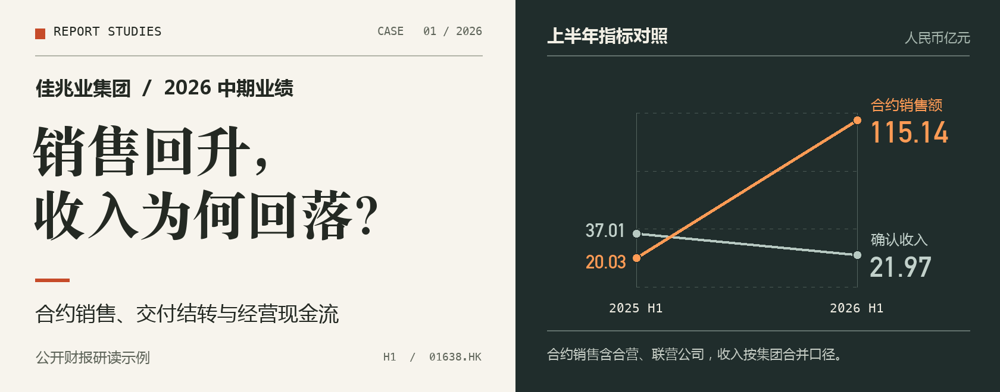
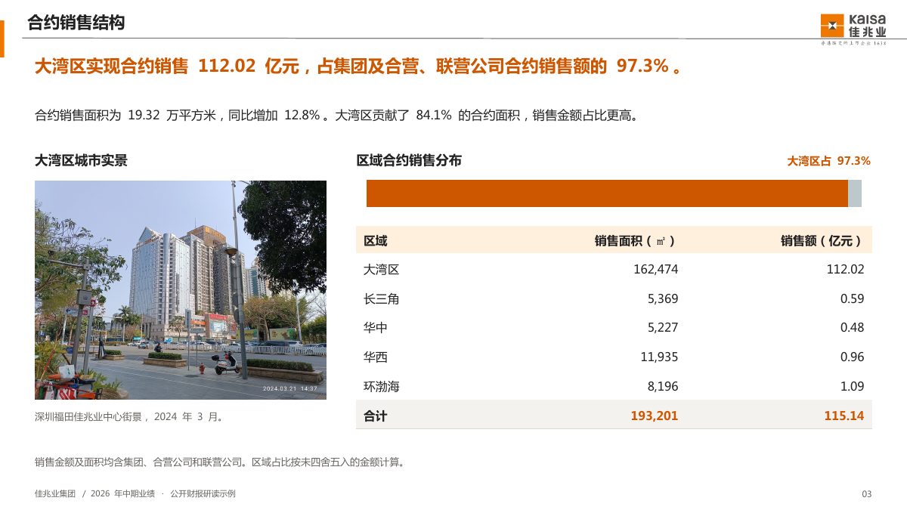
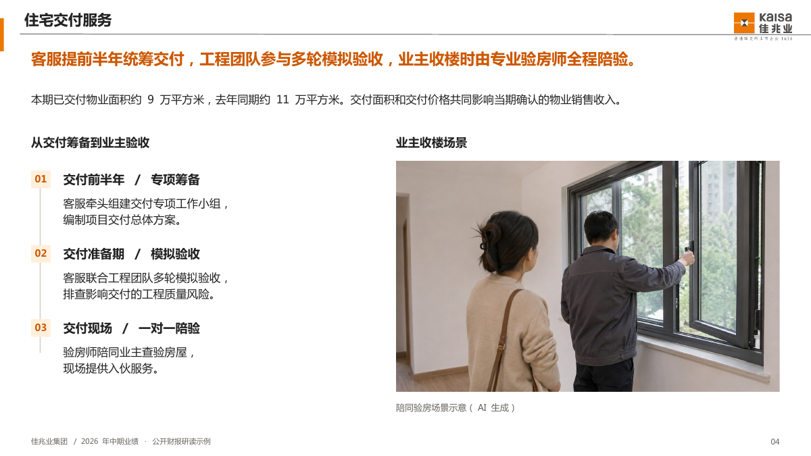
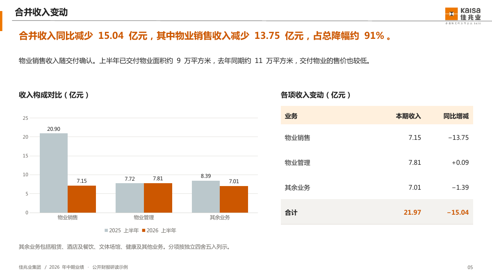
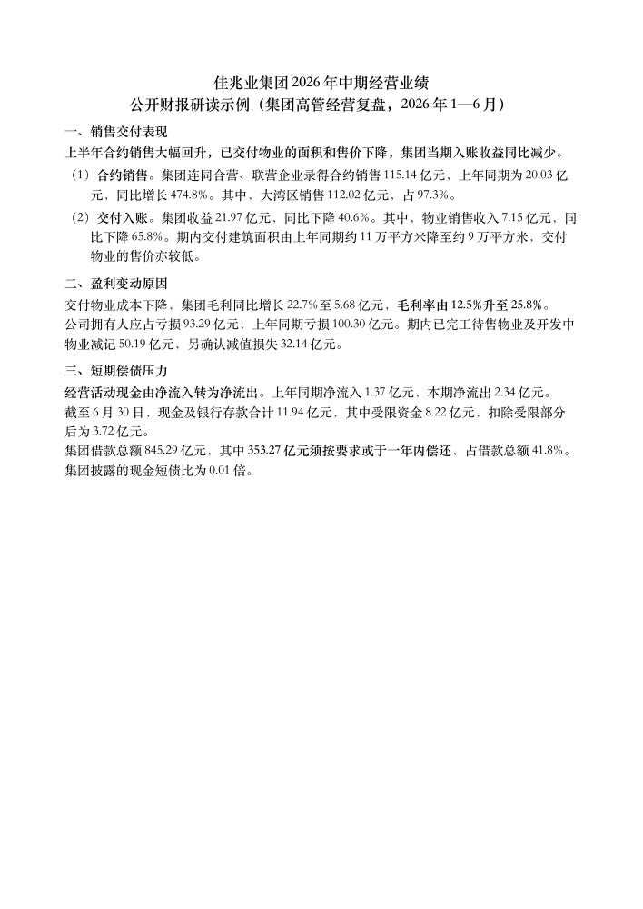

# 佳兆业通用汇报

用佳兆业公司模板制作**可编辑 PowerPoint** 和**一张 A4 宋体简报**。适用于各业务板块和职能条线。当前版本 **v3.6**。

**阅读案例**　[8 页汇报 PDF](demo/interim-2026/briefing.pdf)　·　[下载可编辑 PPTX](demo/interim-2026/briefing.pptx?raw=true)　·　[一页纸 PDF](demo/interim-2026/one-page.pdf)　·　[下载 Word](demo/interim-2026/one-page.docx?raw=true)

## 销售回升，收入为何回落？

本例模拟**集团高管经营复盘**，依据公开中报编制。上半年，佳兆业连同合营及联营公司的合约销售额同比增长 **474.8%**。同期集团确认收入下降 **40.6%**。签订销售合同和交付物业入账发生在不同环节。本期交付面积由约 11 万平方米降至约 9 万平方米，交付物业售价也较低，物业销售收入因此减少 **13.75 亿元**，约占集团收入降幅的九成。[港交所披露的《佳兆业集团 2026 中期报告》，第 8、10—11 页](https://www1.hkexnews.hk/listedco/listconews/sehk/2026/0929/2026092901824_c.pdf)

**实景、示意、数据图分别承担一项工作。** 第 3 页把深圳城市实景与区域销售分布并列；第 4 页用交付时间线和陪同验房场景讲清客服、工程与业主的关系；第 5 页用原生图表拆解收入降幅。点击内页可放大。

 

<strong>展开预览 · 物业销售收入减少了多少</strong>

第 6 页解释为何毛利率提高至 **25.8%**，集团仍录得亏损。第 7 页区分经营现金流与期末余额，上半年经营活动由净流入 **1.37 亿元** 转为净流出 **2.34 亿元**，6 月末非受限现金及银行结余为 **3.72 亿元**。

<strong>展开预览 · 同一组数据怎样写成一页纸</strong>

一页纸按销售与交付、毛利与亏损、现金与短债分节。正文用宋体小四、固定 18 磅行距，关键判断加粗。

本案例依据集团公开披露编制，供演示汇报方法使用。金额以人民币列示。正式披露见[中期业绩公告（8 月 31 日）](https://www1.hkexnews.hk/listedco/listconews/sehk/2026/0831/2026083102314_c.pdf)和[中期报告（9 月 29 日）](https://www1.hkexnews.hk/listedco/listconews/sehk/2026/0929/2026092901824_c.pdf)。

区域实景由 Himleion Waong Ning 于 2024 年 3 月拍摄，采用 CC0 许可。陪同验房图为 AI 生成的业务场景示意，图注已标明。[深圳福田佳兆业中心原图及许可](https://commons.wikimedia.org/wiki/File:SZ_深圳_Shenzhen_福田_Futian_深南中路_Shennan_Middle_Road_March_2024_R12S_02.jpg)

## 同一组资料，按汇报对象取舍

| 本次给谁看 | 正文优先回答什么 |
| --- | --- |
| 董事局主席 | 核心经营结果如何，影响全局的判断是什么，哪些重大事项确需决定。 |
| 高管 | 分管目标差在哪里，主要原因和经营影响是什么，哪些资源或跨部门事项需要协调。 |
| 业务口内部 | 谁做什么，按什么口径和时点交付，出现例外怎样处理和交接。 |
| 对外 | 对方需要了解什么、配合什么。面向投资者按公开披露口径，面向合作方讲双方交付，面向客户讲服务与权益。 |

按本次会议、原案和实际职责确定主读者，具体岗位沿用公司已有称谓。投资、酒店、文商旅及其他业务或职能都可使用。每页单独判断是否配图、图要讲什么、从哪里取得。标的现状可查尽调实图，酒店接待可用现场动线，文商旅方案可用场地总图或拟议布置。缺少合适实图时，按本页问题制作自然可信的场景、机制或方案示意。[受众与使用场合](artifact-template-kaisa-ppt/references/report-options.md) · [逐页配图方法](artifact-template-kaisa-ppt/references/composition-detail.md#业务配图)

## 按汇报内容选版式

| 这页要讲清什么 | 可编辑样例 |
| --- | --- |
| 一场活动如何分时段执行，媒体何时预热、采风和发布 | [单日流程轴与媒体排期](artifact-template-kaisa-ppt/assets/event-and-media-schedule.pptx?raw=true) |
| 几个月的推售、传播、活动、客户拓展如何配合 | [跨月营销总排期](artifact-template-kaisa-ppt/assets/marketing-schedule-overview.pptx?raw=true) |
| 项目判断、分项安排和总预算如何在一张纸上读清 | [结构化 Word 示例](artifact-template-kaisa-ppt/assets/one-page-structured-example.docx?raw=true) |

## 开始使用

把整个 `artifact-template-kaisa-ppt` 文件夹放入个人技能目录。Codex 使用 `~/.codex/skills/`，WorkBuddy 使用 `~/.workbuddy/skills/`。

> 用佳兆业通用汇报技能，把这份经营月报做成管理层会议 PPT，讲清收入差额来自哪些业务、对现金有什么影响，另附一页纸。

[技能入口](artifact-template-kaisa-ppt/SKILL.md)　·　[原生 PPT 模板](artifact-template-kaisa-ppt/references/sources.md)　·　[紧凑 Word 母版](artifact-template-kaisa-ppt/assets/one-page-report.docx?raw=true)　·　[经营汇报写法](artifact-template-kaisa-ppt/references/decision-and-marketing-brief.md)
